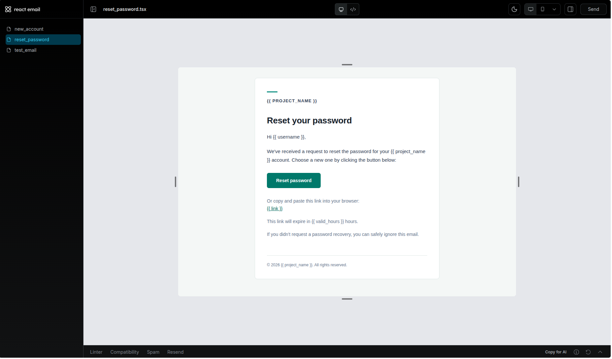
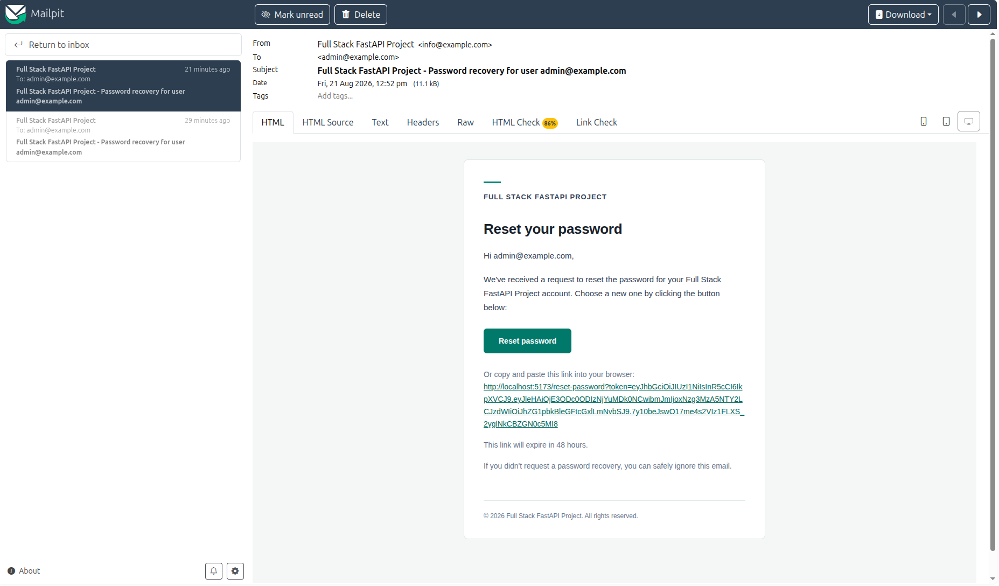
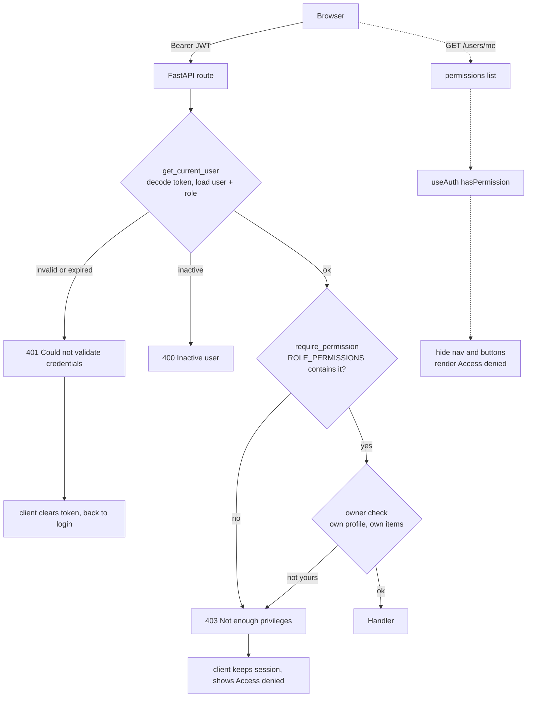

# Full Stack FastAPI Template

[](../../actions/workflows/test-docker-compose.yml)
[](../../actions/workflows/test-backend.yml)

## Technology Stack and Features

- ⚡ [**FastAPI**](https://fastapi.tiangolo.com) for the Python backend API.
  - 🧰 [SQLModel](https://sqlmodel.tiangolo.com) for the Python SQL database interactions (ORM).
  - 🔍 [Pydantic](https://docs.pydantic.dev), used by FastAPI, for the data validation and settings management.
  - 💾 [PostgreSQL](https://www.postgresql.org) as the SQL database.
- 🚀 [React](https://react.dev) for the frontend.
  - 🧩 Built into the backend application and served by FastAPI on the same domain as the API.
  - 💃 Using TypeScript, hooks, [Vite](https://vitejs.dev), and other parts of a modern frontend stack.
  - 🎨 [Tailwind CSS](https://tailwindcss.com) and [shadcn/ui](https://ui.shadcn.com) for the frontend components.
  - 🤖 An automatically generated frontend client.
  - 🧪 [Playwright](https://playwright.dev) for end-to-end testing.
  - 🦇 Dark mode support.
- ☁️ [FastAPI Cloud](https://fastapicloud.com) for deployment.
- 🐋 [Docker Compose](https://www.docker.com) for local services and self-hosted deployment.
  - 📞 [Traefik](https://traefik.io) as a reverse proxy with automatic HTTPS.
- 🔒 Secure password hashing by default.
- 🔑 JWT (JSON Web Token) authentication.
- 📫 Email-based password recovery.
- ✉️ [React Email](https://react.email) for email templates.
- 📬 [Mailpit](https://mailpit.axllent.org) for local email testing during development.
- ✅ Tests with [Pytest](https://pytest.org).
- 🏭 CI (continuous integration) and CD (continuous deployment) based on GitHub Actions.

### Dashboard Login


### Dashboard - Admin


### Dashboard - Items


### Dashboard - Dark Mode


### React Email Templates



### Mailpit - Local Email Testing



### Interactive API Documentation


## How to Use It

Click the **Use this template** button at the top of this page to create a new repository.

## Quick Start

Start the supporting services, then migrate and seed the database:

```bash
docker compose up -d db mailpit
cd backend
uv sync
uv run bash scripts/prestart.sh   # runs migrations, then seeds users
uv run fastapi dev
```

In another terminal, from the project root:

```bash
bun install
bun run dev
```

The frontend runs at <http://localhost:5173> and the API at <http://localhost:8000>, with interactive docs at <http://localhost:8000/docs>.

### Seeded Accounts

`scripts/prestart.sh` seeds one account per role. All three use the password in
`FIRST_SUPERUSER_PASSWORD` (`changethis` by default).

| Email | Role |
| --- | --- |
| `admin@example.com` | admin |
| `manager@example.com` | manager |
| `member@example.com` | member |

The admin comes from `FIRST_SUPERUSER` and is always created. The manager and member
are demo accounts, seeded only when `FASTAPI_ENV=development`, so a deployment gets
the admin alone. Seeding creates missing accounts and never modifies existing ones —
to change a seeded user's role, edit it in the app or delete the row and re-run.

### Running Tests

```bash
cd backend && uv run bash scripts/tests-start.sh   # backend, with coverage
bun run test                                       # end-to-end, Playwright
```

Or run the whole suite in Docker from the project root with `bash ./scripts/test.sh`.

## Authorization

The app has three roles. `admin` has full access, `manager` can see the user
directory and metrics but change neither, and `member` can only reach their own
account and the basic app features.

| Action | admin | manager | member |
| --- | :---: | :---: | :---: |
| List all users | ✅ | ✅ | ❌ |
| Create user | ✅ | ❌ | ❌ |
| View metrics | ✅ | ✅ | ❌ |
| Update own profile | ✅ | ✅ | ✅ |
| Update any profile | ✅ | ❌ | ❌ |

Roles do not grant actions directly. Each row above is a named permission, and a
role holds a set of them:

| Action | Permission | Enforced at |
| --- | --- | --- |
| List all users, read any user | `users:read` | `GET /users/`, `GET /users/{id}` |
| Create user | `users:create` | `POST /users/` |
| Update or delete any user | `users:manage` | `PATCH`/`DELETE /users/{id}` |
| Read or modify others' items | `items:read_any` | `/items/*` |
| View metrics | `metrics:read` | `GET /metrics/` |
| Operational endpoints | `settings:manage` | `POST /utils/test-email/` and similar |

**Where the checks live.** [`app/core/permissions.py`](./backend/app/core/permissions.py)
holds the entire model: the `Role` and `Permission` enums and the `ROLE_PERMISSIONS`
table mapping one to the other. Routes never test a role directly. Instead they
declare the permission they need as a FastAPI dependency —
`dependencies=[Depends(require_permission(Permission.USERS_READ))]` — which runs after
authentication and before the handler, and returns `403` when the role lacks it. Using
dependencies rather than middleware means each route states its own requirement next to
its signature, and the requirement shows up in the OpenAPI schema. Two places check
inline instead, both because access also depends on *who* the record belongs to:
`GET /users/{id}`, where you may always read yourself, and the item routes, where the
owner always has access. Acting on your own account is an identity check, not a
permission, which is why "update own profile" has no entry in the permission table.

**How roles are stored and validated.** A single `role` column on the `user` table,
typed as a Python `StrEnum` and stored as `VARCHAR(20)` rather than a native Postgres
enum, so adding a role needs no `ALTER TYPE` migration. It replaces the template's
original `is_superuser` boolean outright — there is one field, so there is nothing to
contradict. The role is read from the database on every request as part of loading the
current user; it is deliberately **not** a JWT claim, so changing someone's role takes
effect on their next request instead of when their token expires. Signup and
`PATCH /users/me` cannot set it: `UserRegister` and `UserUpdateMe` simply have no
`role` field, so new accounts are always `member` and nobody can promote themselves.

**How the frontend learns capabilities.** `GET /users/me` returns the user plus the
list of permissions their role grants. `useAuth()` exposes `hasPermission("users:read")`,
and the UI asks that question wherever it hides a nav link, a button, or a page. The
frontend holds no copy of the permission table, so the two can never drift, and
changing who may do what is a backend-only change. The UI is advisory: it hides what
you cannot use so you are not led into a dead end, but every rule is enforced again on
the server, and a `403` renders an "Access denied" page rather than failing silently.



The dotted path is the frontend hiding what you cannot use; the solid path is the
backend enforcing it. Design decisions behind this are recorded in
[docs/adr/](./docs/adr).

## Backend Development

Backend docs: [backend/README.md](./backend/README.md).

## Frontend Development

Frontend docs: [frontend/README.md](./frontend/README.md).

## Deployment

FastAPI Cloud deployment: [deployment.md](./deployment.md).

Self-hosted deployment with Docker Compose: [deployment-docker-compose.md](./deployment-docker-compose.md).

## Development

General development docs: [development.md](./development.md).

This includes the local FastAPI and Vite workflow, Docker Compose services, `.env` configuration, and more.

## Release Notes

Check the file [release-notes.md](./release-notes.md).

## License

The Full Stack FastAPI Template is licensed under the terms of the MIT license.
